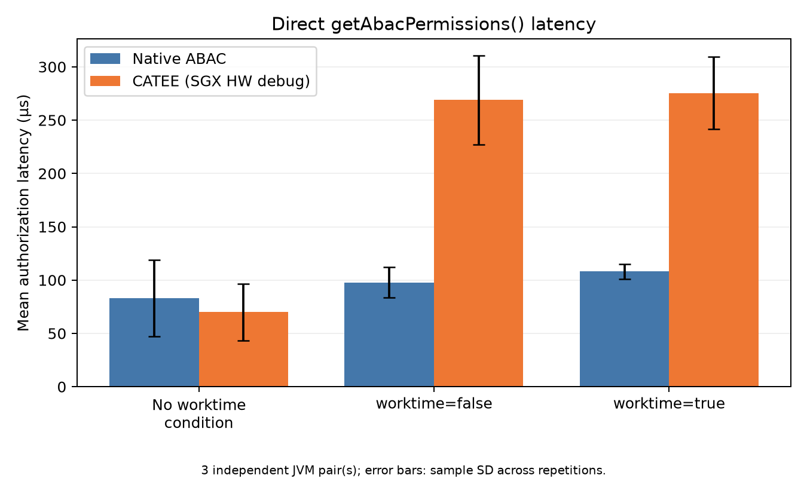
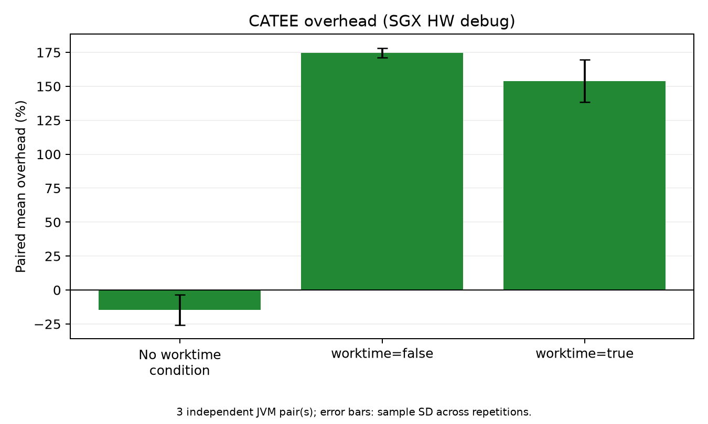

# CATEE authorization comparison — 22 October 2026

This dataset compares direct native ABAC authorization with CATEE on real SGX
hardware. All six JVM runs completed and returned the expected permissions.
The dataset contains 180,000 retained calls; no historical experiment data was
rerun or replaced.

## Results

Latencies below are microseconds, expressed as mean ± sample SD of the three
independent JVM repetition means. Overhead is the mean of the three paired
SGX/native ratios, expressed as a percentage; its SD is in percentage points.
These are descriptive statistics, not confidence intervals.

| Workload | Native ABAC (µs) | CATEE (µs) | Paired overhead |
| --- | ---: | ---: | ---: |
| No worktime condition | 83.09 ± 35.80 | 69.92 ± 26.58 | −14.54% ± 11.17 pp |
| worktime=false | 97.83 ± 14.10 | 268.88 ± 41.61 | +174.58% ± 3.59 pp |
| worktime=true | 108.19 ± 6.97 | 275.33 ± 33.91 | +153.86% ± 15.60 pp |

The two working-hours workloads added a mean paired 171.05 µs and 167.14 µs,
respectively: approximately 0.17 ms per authorization call in this session.
Their mean paired latency ratios were 2.746× and 2.539×. This includes the Java
client, connection setup, native-service dispatch, ECALL, and result handling;
it does not isolate the cost of executing code inside SGX.

The no-worktime control makes no timed SGX requests. Its lower recorded CATEE
mean is not evidence that SGX speeds up authorization. Control repetition means
span 61.88–124.42 µs in native mode and 48.29–99.60 µs in CATEE mode, showing
substantial JVM/session variation. Run order, JIT/cache behavior, scheduling, and
background activity remain possible influences; this experiment does not isolate
their contributions. Three repetitions in one session are insufficient for broad
performance claims.





Editable vector versions: [latency SVG](analysis/latency.svg) and
[overhead SVG](analysis/overhead.svg).

## Protocol and provenance

- Source revision: `893352d594e4c7477fce63ff2407e00c77a27e45`.
  The tracked checkout was clean. Only the two untracked design drafts recorded
  in `metadata.json` were present; they are not benchmark code.
- Session: 2026-10-22 14:25:29–14:27:24 UTC (19:55:29–19:57:24 IST).
- Host: `jayjanibtp`, Intel Core i5-6500, x86_64, kernel `5.15.0-198-generic`.
- SGX: legacy `/dev/isgx`, AESM active, SDK `2.27.100.1`, runtime/AESM packages
  `2.27.100.1-jammy1`, real hardware with a debug enclave.
- Java `11.0.32.1`; complete software details and binary hashes are in
  [metadata.json](metadata.json). Plotting used Matplotlib `3.11.2`.
- Three fresh JVM pairs. Mode order: native/SGX, native/SGX, SGX/native. Scenario
  order is seeded per repetition and shared by its mode pair.
- Each point loads its one-rule policy and matching user/resource attributes
  once, before 10 discarded warmup batches and 100 retained batches of 100 calls.
  Thus each scenario/mode/repetition retains 10,000 calls.
- Only `CassandraAuthorizer.getAbacPermissions()` is timed, including its
  authorization-table reads. Configuration loading, assertions, CSV writes,
  startup, sealing, RBAC union, final permission caching, and end-user CQL
  execution are excluded. This is sequential, single-caller authorization
  latency, not database throughput or a concurrency/scaling experiment.
- Native mode uses the same host-local 09:00-inclusive/17:00-exclusive predicate
  as the enclave. This session ran outside that window: the control and
  `worktime=false` granted ABAC SELECT, while `worktime=true` returned no ABAC
  permissions. All modes/repetitions agreed, and no boundary was crossed.
- The runner did not change CPU affinity, frequency settings, the SGX
  installation, or Cassandra production configuration.

The six `repeat-*.csv` files are unmodified raw samples. The `analysis/` directory
contains batch/repetition/point summaries, paired comparisons, and plots. Full
local logs and fresh JUnit reports remain under ignored
`tee/catee/build/measurements/full-20261022-1955/`; build outputs, keys, sockets,
and sealed runtime state are not committed.

## Reproduce

From the repository root, use fresh output directories:

```bash
source ~/sgxsdk/environment
python3 tee/catee/test/benchmark_abac.py tee/catee/build/measurements/full-NEW
python3 -m venv tee/catee/.local/analysis-venv
tee/catee/.local/analysis-venv/bin/python -m pip install -r tee/catee/test/requirements-analysis.txt
tee/catee/.local/analysis-venv/bin/python tee/catee/test/analyze_benchmark.py tee/catee/build/measurements/full-NEW tee/catee/build/analysis-NEW
```

To reanalyze the committed raw data, replace the input directory with
`benchmarks/catee/comparison-2026-10-22`, keeping a new output directory. The
original run used default full-protocol settings and three pairs. Repository
copies of the six raw CSVs and metadata were checked byte-for-byte against its
local output before analysis.

## Security scope

This is a PATEE-style local prototype: the enclave holds the working-hours
window and administrative privilege table, performs their supported checks, and
seals administrative state. Policies, ordinary user/resource attributes, most
ABAC evaluation, and enforcement remain in Cassandra. A modified Cassandra
process can bypass enforcement. Host time and caller identity are trusted
inputs; same-UID service clients can provision administrative grants directly.

Debug enclaves do not establish production confidentiality against privileged
debugging. There is no remote attestation, authenticated enclave channel,
rollback protection, or claim that the entire ABAC engine is enclave-protected.
Sealing detects altered bytes but does not prevent deletion or replay of an old
valid file. New CQL administration syntax remains deferred pending a decision.
